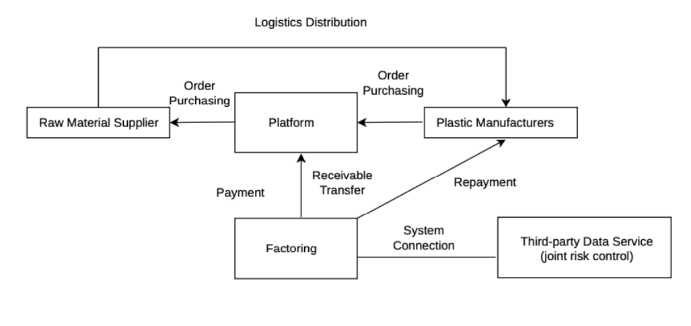
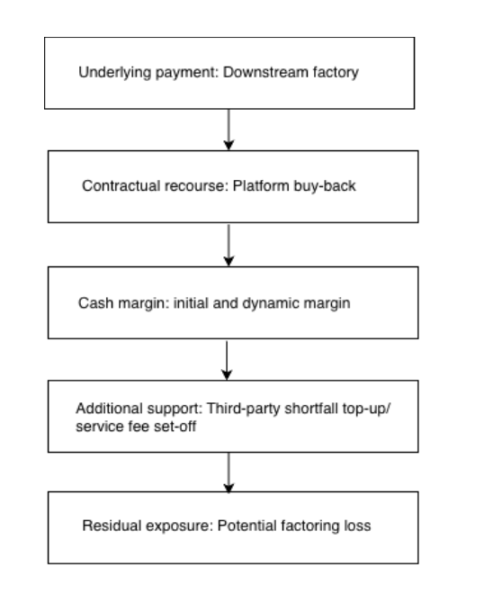
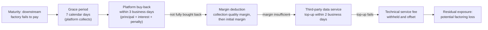
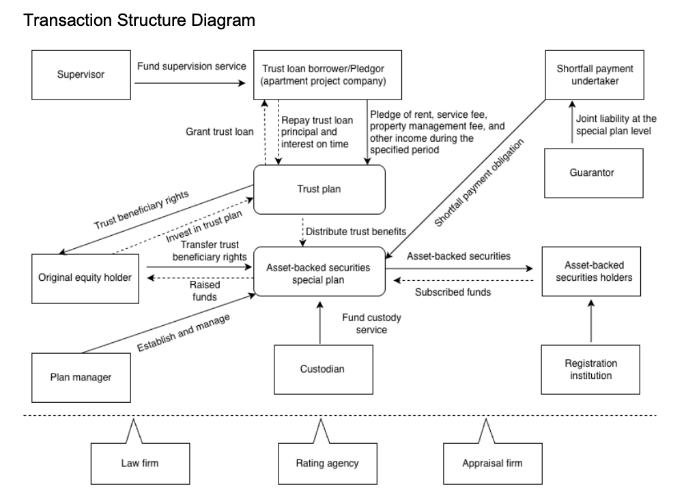
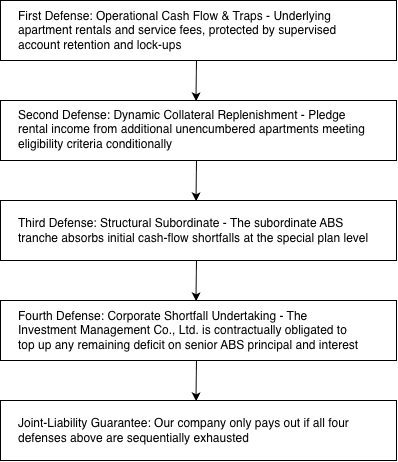

# Professional Case Studies
**Note:** Case studies are anonymized and partially reconstructed analyses based on prior institutional experience, with certain parameters normalized or concealed for confidentiality.

## Case Study 01 — Structured Supply-Chain Financing (Case report: [Google Doc](https://drive.google.com/file/d/1DHXPMmhC69-cVd9VgK_jC0-A4EHye_gb/view?usp=sharing))
 

### Structure & Original Repayment Analysis 
-  The entire structure involves four parties: downstream manufacturers, platform, the factoring company, third-party data service. The downstream plastics manufacturers place purchase orders with the platform for raw materials. The platform assigns to the factoring company the future accounts receivable arising from the purchase orders confirmed by the downstream factory (a with-recourse assignment), and the factoring company pays the assignment consideration. The downstream manufacturer pays the corresponding order purchase amount to the factoring company upon maturity. If the downstream factory fails to pay the purchase amount on time, during the 7-day grace period, the following risk controls are implemented sequentially: the platform overdue debt repurchase; deduction of retained margin; shortfall top-up and technical service fee deduction from the third-party data service.

-  The transaction structure, the contractual recourse and credit-support waterfall are shown as follow:

-  The full timeline is shown as follow:

### Structural Vulnerabilities
- Co-managed account suffers vulnerability: it does not eliminate the judicial-freezing risk. Dual-key approval and operational control do not necessarily establish proprietary priority or insolvency protection.
- Obligations of counterparties are time-bound, enforced operationally, rather than through tranche write-down mechanics.

### Retrospective Quantitative Extension
**MOB vintage:**
-  The heatmaps indicate that risk management has a chance to intervene in the early-stage situation, whereas near 100% roll dominates the 61-90D to 90D+ transition.
-  2018 vintage reflects the deterioration: peak cumulative 90+ of roughly 0.23% of disbursement at MOB 4, against roughly 0.14% for 2017.

**Rolling rate:**
- The pooled roll rates: 4.6% for 1–7D, 27.0% for 8–30D, 36.2% for 31–60D and 47.9% for 61–90D.
- The cliff, 5.89x supports setting the contractual 7-day grace period and enforcing the platform’s 3-business-day buy-back obligation at Day 10.
- Self-cure collapses after 30 days, indicating recourse should be exercised before 30D+.

### Credit Decision & Lessons
- This is the order financing based on future receivable from purchase orders of downstream manufacturers.
- Ongoing post loan monitoring is required, since the use of loan funds by the platform is not controlled.
- Risk identification of downstream factories depends on the third-party data service and the platform.
- The co-managed account cannot eliminate the judicial freezing risk, and the practical operational mitigant is minimizing funds' residence time via prompt clearing, though it reduces exposure rather than removes the legal risk.

### Quantitative Implementation(python notebook)
- Vintage_MOB.ipynb
- Roll_rate.ipynb

### Monitoring Framework
- Asset leg drives PD, support leg drives LGD, with 3-level escalation

### Securitization Comparison
- This case is more like a guarantee stack, not credit tranching.

## Case Study 02 — ABS / Trust Structured Financing  (Case report: [Google Doc](https://drive.google.com/file/d/1L2w2lhc8OxJmuqxgwyxSGm516rD9ILiq/view?usp=sharing))

### Transaction Structure and Waterfall
- It is a dual-SPV structure, including front-end fund trust plan and back-end ABS issuance plan.
- The transaction structure and loss waterfall are shown as follow:

### Original Underwriting and Guarantor Exposure
- Based on the sequential waterfall, cash-flow payouts are triggered if a) net rental collections breach the threshold of coverage lock-ups; b) the borrower fails to replenish the pool with eligible apartment receivables when occupancy drops below X%; c) the subordinate tranche is exhausted; d) Investment Management Co., Ltd. defaults on its shortfall payment undertaking.

### Vulnerabilities, Decision and Lessons
- Wrong-way risk: a) relations between collateral deterioration and credit-support failure; b) red-chip structure renders a critical divergence between PRC GAAP and IFRS. IFRS fair-value markups inflate book equity, and a downturn in occupancy or rates writes them down at the same time, wiping out the undertaker's equity and making the equity pledge worthless.
- It is reasonable to propose an unaffiliated trust plan to provide liquidity support, and pay special attention to their pivotal U.S. institutional investor, tracking its follow-on funding commitment.
- Post-guarantee Recovery (impact on LGD): a 3-year future rent/service-fee pledge is a time-decaying asset; renovation capex has zero standalone liquidation value; downstream sublease receivables are subordinated to upstream master-lease obligations.
- The occupancy is crucial in the calculation of cash flow coverage. Therefore, it is essential to do cross-verification of occupancy, and it includes on-site audit, third-party projection, financial statement back-solving. The method used by the third-party is accrual-basis accounting. However, from a liquidity perspective, it is more reasonable to emphasize on realized monthly cash flow.

### Comparison with Publicly Issued Cases
- Compared to the publicly issued cases before 2020, the structure of this case remains internally consistent and its controls, including cash trap, coverage lock-ups, the closed-loop indicator, takeover of the Alipay/Wechat collection accounts and the equity pledge, are stronger than the public template. 
- Post-2020, the rental-housing securitization migrated to state-backed/insured channels.

